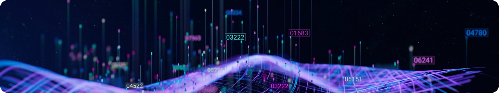

# Hi, I'm William 👋

### Electrical & Electronics Engineering student building intelligent hardware systems

I work across **ASIC design, FPGA, RTL verification, Edge AI, embedded systems, DSP, and engineering software**. My favorite problems sit at the boundary between architecture and reality: turning an idea into hardware that can be verified, measured, and used.

> Always learning. Code, create, connect.

## Now

- Studying Electrical and Electronics Engineering at Institut Teknologi Bandung
- Exploring the path from **architecture to RTL, verification, physical implementation, and deployment**
- Building systems that make computation more efficient, measurable, and useful

## Featured work

### Signed INT8 GAN Accelerator

An RTL-to-GDSII accelerator built around a 4x4 processing-element array, SRAM buffers, and post-route bit-exact verification. The project is a practical study in hardware architecture, implementation, and proof.

### GARDA Chip Explorer

Explore the GARDA chip project and its design through an interactive presentation.

### IGOR - Indonesian Gated Onboard Robotics

An FPGA neural accelerator for a mobile robot, developed by team iSeeDesignITB for the PERURI Chip Hackathon 2026. Explore the RTL and project details through the linked IGOR explorer.

### Other areas I enjoy

`Digital design` `Computer architecture` `Verification` `Embedded systems` `Edge AI` `Signal processing` `Developer tools`

## Find me

  · [Portfolio](https://wlmoi.vercel.app/) · [GitHub](https://github.com/wlmoi)

## Tools in this portfolio

 

## GitHub activity

  
  

## About this repository

This repository contains the source for my portfolio website and print-friendly resume. The website details, local setup, Supabase configuration, deployment notes, and accessibility decisions live in the [website guide](docs/website.md). The reusable [design practices](docs/design-practices.md) and [color system](docs/color-system.md) document the portfolio's visual and interaction direction.

Thanks for stopping by. There is always another layer to learn.

## References

### Packages

All direct runtime and development packages used by this repository are listed below. Exact transitive versions are recorded in [package-lock.json](package-lock.json).

| Package | Version | Use |
| --- | --- | --- |
| [@react-three/drei](https://www.npmjs.com/package/@react-three/drei) | 10.7.8 | Three.js scene helpers |
| [@react-three/fiber](https://www.npmjs.com/package/@react-three/fiber) | 9.7.0 | React renderer for Three.js |
| [@supabase/supabase-js](https://www.npmjs.com/package/@supabase/supabase-js) | 2.116.0 | Contact storage client |
| [gsap](https://www.npmjs.com/package/gsap) | 3.15.0 | ScrollTrigger, reveals and particle typography |
| [lucide-react](https://www.npmjs.com/package/lucide-react) | 1.47.0 | Interface icons |
| [react](https://www.npmjs.com/package/react) | 19.2.0 | Component UI |
| [react-dom](https://www.npmjs.com/package/react-dom) | 19.2.0 | DOM rendering |
| [react-router-dom](https://www.npmjs.com/package/react-router-dom) | 6.30.6 | Page routing |
| [three](https://www.npmjs.com/package/three) | 0.185.1 | 3D keyboard, circuit atlas and particles |
| [three-fluid-fx](https://www.npmjs.com/package/three-fluid-fx) | 0.1.0 | Interactive fluid simulation |
| [zod](https://www.npmjs.com/package/zod) | 4.6.5 | Form validation |
| [@eslint/js](https://www.npmjs.com/package/@eslint/js) | 9.39.2 | Development: types, linting, styling or build tooling |
| [@types/react](https://www.npmjs.com/package/@types/react) | 19.0.0 | Development: types, linting, styling or build tooling |
| [@types/react-dom](https://www.npmjs.com/package/@types/react-dom) | 19.0.0 | Development: types, linting, styling or build tooling |
| [@types/three](https://www.npmjs.com/package/@types/three) | 0.185.4 | Development: types, linting, styling or build tooling |
| [@vitejs/plugin-react](https://www.npmjs.com/package/@vitejs/plugin-react) | 6.1.1 | Development: types, linting, styling or build tooling |
| [autoprefixer](https://www.npmjs.com/package/autoprefixer) | 10.6.1 | Development: types, linting, styling or build tooling |
| [eslint](https://www.npmjs.com/package/eslint) | 9.39.2 | Development: types, linting, styling or build tooling |
| [eslint-plugin-react-hooks](https://www.npmjs.com/package/eslint-plugin-react-hooks) | 7.0.0 | Development: types, linting, styling or build tooling |
| [eslint-plugin-react-refresh](https://www.npmjs.com/package/eslint-plugin-react-refresh) | 0.4.20 | Development: types, linting, styling or build tooling |
| [postcss](https://www.npmjs.com/package/postcss) | 8.5.28 | Development: types, linting, styling or build tooling |
| [tailwindcss](https://www.npmjs.com/package/tailwindcss) | 3.4.19 | Development: types, linting, styling or build tooling |
| [typescript](https://www.npmjs.com/package/typescript) | 5.9.3 | Development: types, linting, styling or build tooling |
| [typescript-eslint](https://www.npmjs.com/package/typescript-eslint) | 8.70.0 | Development: types, linting, styling or build tooling |
| [vite](https://www.npmjs.com/package/vite) | 8.3.0 | Development: types, linting, styling or build tooling |

### Visual references and attribution

- [GSAP](https://github.com/greensock/GSAP): animation engine and ScrollTrigger.
- [three-fluid-fx](https://github.com/artcodev/three-fluid-fx): fluid velocity/density fields drive original lattice, trefoil, vortex and combined particle shaders. [MIT license](public/licenses/three-fluid-fx.txt) and [third-party notices](public/licenses/three-fluid-fx-third-party.txt).
- [Txemalon/3d-portfolio](https://github.com/Txemalon/3d-portfolio): inspiration for the skills keyboard. This portfolio uses an original procedural keyboard and original synthesized mechanical click.
- [ladunjexa/reactjs18-3d-portfolio](https://github.com/ladunjexa/reactjs18-3d-portfolio): inspiration for the spatial portfolio presentation.
- EL5013 circuit atlas: William Anthony's supplied LTspice schematics; original wire coordinates, illustrative component blocks.
- [IEEE Chipathon 2025 announcement](https://www.linkedin.com/feed/update/urn:li:activity:7412029754188414976/): linked from the front-page winner badge; Agentic AI theme supplied by William.

### Asset preparation tools

These tools were used in an isolated local cache for asset verification, not shipped in the website runtime: [gdstk 1.0.2](https://heitzmann.github.io/gdstk/) for GDS parsing and SVG geometry export, [PyMuPDF 2.0](https://pymupdf.readthedocs.io/) for source-document previews and PDF rendering, and [pypdf 6.21.2](https://pypdf.readthedocs.io/) for PDF text/structure checks. The browser export uses Chromium through Playwright for print-layout and interaction QA. See the [evidence archive notes](docs/evidence.md).

### Planar CMOS model

The original procedural NMOS/PMOS model takes visual inspiration from [planar_Invertor on Sketchfab](https://sketchfab.com/3d-models/planar-invertor-5f8dbf311b194676b35cff3b8817c13d). No Sketchfab model, texture or thumbnail is distributed. Structure and ideal inverter logic follow [Johannes Kepler University CMOS teaching material](https://iic-jku.github.io/design-complex-ic/slides/mosfet.html), [MIT OpenCourseWare 3D cross-section notes](https://www.ocw.mit.edu/courses/6-111-introductory-digital-systems-laboratory-spring-2006/175ea2da2a74523af3f3837a5c39b13c_l15_vlsi_print.pdf) and the [UBC CMOS layout tutorial](https://people.ece.ubc.ca/soc/cadence/html/Layout.html). Geometry, colours, labels and interaction code are local, using the existing Three.js, React Three Fiber and Drei dependencies.

### Experience gallery

The experience section uses original CSS perspective photography with GSAP ScrollTrigger, inspired by [Hunterdii's 3D Scrolling Gallery/Timeline](https://github.com/Hunterdii/3D-Scrolling-Gallery-Timeline). The [pmndrs timeline](https://github.com/pmndrs/timeline) was reviewed as a 3D choreography reference; it is not installed. [GSAP DrawSVGPlugin](https://gsap.com/docs/v3/Plugins/DrawSVGPlugin/), included in the existing GSAP package, draws the scroll-progress line. No additional runtime package is required. Role descriptions appear once, responsibilities expand on demand, and native scrolling and deep links are preserved. Reading view and reduced-motion preferences remove the photographic motion; mobile keeps the cards flat.

### Touch controls

The hero supports WebGL2 on mobile as well as desktop. Drag the keyboard or silicon board directly to rotate; rotation is always enabled. Scroll outside the model to move the page, and use **Reset view** to restore framing. Devices without WebGL retain a draggable CSS 3D fallback with solid case, keycap, board and package side faces. Rotation is unrestricted. WebGL supports wheel/pinch zoom and panning; the CSS 3D fallback supports wheel and two-finger pinch zoom. Reduced motion pauses automatic floating while preserving deliberate rotation. Employment metadata uses explicit employment type, location and work arrangement labels.

### Résumé action

The primary résumé link uses an original GSAP magnetic button with corner brackets, a short light sweep, and pointer/focus/touch feedback, inspired by [Ashish's magnetic cursor study](https://codepen.io/ashish1729/pen/LEEwmVm). The effect is local to the button; the system cursor and native `/resume` navigation are preserved. Ambient motion pauses offscreen and in hidden tabs, and reduced-motion preferences disable the GSAP effects.

SVG reference gallery

The following original SVGs are from the supplied Aza Ali README reference. Project names, branding, and the original banner belong to their respective creator and are shown here as design references, not as my work.

### Original banner

### Assets

### Text

